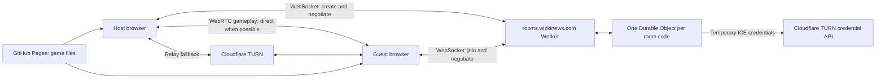

# Cloudflare signaling and level library

This replaces the publicly hosted Node service. Keep the browser game on GitHub Pages;
no always-on PC, Node process, or Cloudflare Tunnel is needed for the public backend.
Anyone visiting the game can host a 2–8 player room and share its eight-digit code.
Host Game defaults to **Private** (code only). Choosing **Public** also lists the room
in Join Game, where players can see its name and player count and click to join.
Both kinds of room still accept the eight-digit code.

The same Worker serves a public level library backed by **D1**. Main menu →
**Level Editor** now offers **Browse Levels** or **Create New**. Browse Levels lists
published courses newest first and lets players play them. Create New opens the existing
editor, preserving any draft from this session. In the editor, **Upload** opens
a level name form and shows the signed-in username. Uploading requires a playable spawn
and a username/password account. Settings offers sign-in, account creation, and sign-out;
clicking Upload while signed out prompts for sign-in or account creation first.
Published community levels can be restarted or left through the pause menu.

## Set up D1 for level publishing

From `server/cloudflare`, with Node.js 22+ and dependencies installed:

```sh
npx wrangler d1 create multi-grappler-levels
```

Copy the returned `database_id` into the `LEVELS_DB` entry of `wrangler.jsonc`.
Keep its binding, database name, and migrations directory. Apply the schema, then
deploy the Worker:

```sh
npm run db:remote
npm run deploy
```

The schema is in `migrations/0001_levels.sql` and `migrations/0002_accounts.sql`.
The second migration adds users, sessions, and account attribution to new levels while
preserving all existing levels. If you already deployed the library, run `npm run db:remote`
again to apply the new migration, then deploy this Worker and re-export the game.
Existing Durable Object migrations remain in `wrangler.jsonc`; D1 migrations run
separately. No D1 token or Cloudflare credentials
belong in the game. Re-export/upload the Web game after deploying this backend.

For local development, **use this Worker instead of `server/signaling.js`** to test
publishing and browsing. The original Node signaling service does not provide D1:

```sh
npm run db:local
npm run dev
```

Local D1 data persists under `.wrangler/state`, separately from production. Database
creation and remote migration are only needed for the hosted service; local development
works with the checked-in binding even before adding a remote database ID.

### Test directly in Godot debug mode

Publishing and browsing work when running the project with **F5** in Godot; no Web
export is needed. Start the local Worker using `npm run db:local` and `npm run dev`
above, then run the game. The default signaling URL also points the library client
to `http://127.0.0.1:9080/levels`. Create a playable level, choose **Upload**, return
to the main menu, and open **Level Editor → Browse Levels** to play it. These records
use local D1 storage, separate from the hosted library. Stop any Node signaling server
already using port 9080 before starting Wrangler.
The dev script preserves localhost request URLs instead of inferring the hosted route,
so local account requests pass the HTTPS-or-localhost transport check.

The dev script and game both use `127.0.0.1` explicitly. HTTP library overrides using
`localhost` are normalized to this same address. If an account request fails, its
message identifies the actual server URL and whether connecting, DNS, TLS, or a timeout
failed. With the Worker running, open `http://127.0.0.1:9080/health` and confirm it says
`ok`. For desktop debug runs, the Worker must run on the same computer as Godot.

To test the deployed Cloudflare service from Godot debug mode, add this setting under
the existing `[network]` section in `project.godot`:

```ini
level_library_url="https://rooms.wizkinews.com/levels"
```

The hosted D1 database, migration, and updated Worker must be deployed first. This
setting uses the hosted library and its real 100 slots. Remove the setting or leave
it empty to return to the local default. A final Web export test checks the browser's
origin/CORS configuration as well.

The game derives `/levels` from its signaling service URL, so production uses
`https://rooms.wizkinews.com/levels` and local runs use `http://127.0.0.1:9080/levels`.
To use a separate level service, set `network/level_library_url` in Godot project
settings, or `window.MULTI_GRAPPLER_LEVELS_URL` in the Web export's HTML head to the
complete `/levels` URL. The HTML setting takes precedence. The Worker uses the same
`ALLOWED_ORIGINS` for level requests, including JSON upload preflights.

## Level library behavior

- `GET /levels`: up to 100 level summaries (`id`, `title`, `author`, `created_at`),
  newest first. Codes are fetched only when a player selects Play.
- `GET /levels/:id`: metadata and the exact portable `MG1-` code.
- `POST /levels`: JSON `{ "title": "Course", "level_code": "MG1-..." }` with an
  `Authorization: Bearer <session-token>` header. Level names are limited to 64 characters.
  The server supplies `author` and `author_id` from the authenticated account; a client
  cannot claim another creator name. Missing, expired, and revoked sessions return `401`.
  Returns `201` for a publication, `200` with `duplicate: true` for a retry of an
  existing level, or `409` when all 100 slots are occupied.

The **100-level cap is global**, enforced by an atomic SQL insert and a database
trigger. A full library rejects new levels and preserves everything already stored;
it never evicts older levels. Identical portable payloads share an ID even if their
compression differs, and retrying them does not consume another slot or change their
published names. Codes remain compatible with the editor's import/export and multiplayer
hosting. Playing a community level leaves the editor draft intact.

Browsing and downloading are public. Publishing requires an account. Existing levels
retain their original creator labels; they are not automatically assigned to new
accounts. There is no editing of published records or in-game deletion. To free a slot,
the owner can delete the chosen record in the D1 dashboard's `levels` table. Uploads are limited
to approximately five per public IP per minute; reads share the existing connection
limiter. Upload bodies, decompression, format, grid bounds, race data, and spawn clearance
are validated before insertion. The Worker stores data only, never executable resources.

`npm test` includes real local D1 tests for publication, browsing, malformed uploads,
duplicate retries, and 110 concurrent uploads competing for 100 slots. Godot checks:

```sh
godot --headless --path ../.. --script tests/level_library_tests.gd
```

With `npm run dev` running, additionally set
`LEVEL_LIBRARY_TEST_URL=http://127.0.0.1:9080/levels` for an actual Godot → Worker → D1
upload/list/download/play test. Use local D1 for this check: it publishes one test level.
The check also creates a temporary test account in local D1 and signs it out.

## Accounts

Usernames contain 3–24 ASCII letters, numbers, or underscores. Names are unique without
regard to case; the original capitalization is displayed on published levels. Passwords
contain 4–32 characters and are not trimmed. Registration signs the player in immediately.
The game checks password confirmation before sending registration.

- `POST /auth/register`: `{ "username": "Player", "password": "a long password..." }`.
- `POST /auth/login`: the same fields. Incorrect usernames and passwords share one error.
- `GET /auth/me`: current account, using the session's Authorization header.
- `POST /auth/logout`: revokes the current session. The game also clears its local session.

Registration and login return the public `user` (`id` and `username`), a session `token`,
and `expires_at` as Unix milliseconds. Sessions expire after 24 hours, and each account can
have at most five live sessions. The game keeps its token in memory, shared across the
editor and Settings. Closing or reloading the game requires signing in again. Passwords
are never saved on the device. There is no email verification or password recovery in
this initial username/password account system.

D1 stores a unique salt and a scrypt hash for each password, plus SHA-256 hashes of
random 256-bit session tokens. It does not store passwords or usable session tokens.
The scrypt-v1 profile uses N=16384, r=8, p=5 (16 MiB), following an
[OWASP scrypt profile](https://cheatsheetseries.owasp.org/cheatsheets/Password_Storage_Cheat_Sheet.html#scrypt).
The Worker enables Node.js compatibility for `node:crypto`; its CPU ceiling is 1000 ms
to accommodate password hashing. Account traffic is limited per IP and per normalized
username, with a separate registration limit. Authentication and authenticated uploads
require HTTPS except on localhost. Both HTTP APIs allow the Authorization header in
browser preflights; account request bodies, passwords, and tokens are never logged by
the application.

Run `godot --headless --path ../.. --script tests/account_tests.gd` for Settings and
account form checks. Backend `npm test` checks password hashes, username uniqueness,
forged creator names, revoked/expired sessions, rate limits, and migration compatibility.

References: [D1 prepared statements](https://developers.cloudflare.com/d1/worker-api/prepared-statements/)
and [D1 migrations](https://developers.cloudflare.com/d1/reference/migrations/).
See also [local D1 development](https://developers.cloudflare.com/d1/best-practices/local-development/).

## Deploy from your computer

Use **Node.js 22 or newer** (current Wrangler requires it). From a terminal in the repo:

```sh
cd server/cloudflare
npm ci
npx wrangler login
npx wrangler whoami
```

Sign into the Cloudflare account that owns `wizkinews.com`. If you have multiple accounts,
set `account_id` in `wrangler.jsonc` to the intended account ID before continuing.

Set these two **Worker secrets**, entering the matching values already in `server/.env`
at the prompts. The local Node `.env` does not upload itself to Cloudflare.

```sh
npx wrangler secret put CLOUDFLARE_TURN_KEY_ID
npx wrangler secret put CLOUDFLARE_TURN_API_TOKEN
npm run deploy
```

Wrangler may offer to create the Worker during the first secret upload; accept that.
The TURN token must be allowed to generate credentials for the matching TURN key.
Never put either value in Godot, browser HTML, `wrangler.jsonc`, or Git.

The checked-in configuration creates the `multi-grappler-rooms` Worker, a SQLite Durable
Object namespace, and the custom domain **rooms.wizkinews.com**. Cloudflare manages DNS
and HTTPS for the custom domain; you do not need to point an A record at a server.
If `rooms` already has a DNS record or Tunnel route, remove that conflicting `rooms`
configuration first. Leave the GitHub Pages records for the main website as they are.
The first migration (`v1`) creates the room namespace; `v2` adds the public lobby
directory. Keep both migrations in the config for future deploys. Existing clients
that omit visibility continue to create private rooms.

Open `https://rooms.wizkinews.com/health`; it should show `ok`. This checks that the
Worker is reachable, not that TURN credentials are valid. An actual Host/Join verifies
credential generation. `npx wrangler tail` shows runtime errors without logging secrets
or signaling payloads in our application code.

Then re-export the **Web** preset in Godot and upload the updated game to GitHub Pages.
The game automatically uses `wss://rooms.wizkinews.com` on `wizkinews.com` and
`www.wizkinews.com`. Localhost uses the local signaling service. On other domains, set
this before loading the Godot engine in the exported HTML (or the iframe's HTML):

```html
<script>window.MULTI_GRAPPLER_SIGNALING_URL = "wss://rooms.wizkinews.com";</script>
```

If the game lives in an iframe, allow the **iframe's origin** in `ALLOWED_ORIGINS`, not
just the parent page's origin. The checked-in origins cover your main website and local
port 8000. Add another exact origin to `wrangler.jsonc` and redeploy when needed.

## Test without deploying

```sh
cd server/cloudflare
npm ci
npm test
npm run check
npm run dev
```

`dev` serves the Worker and real local Durable Objects at `http://127.0.0.1:9080`.
Stop the original Node service first, since both use port 9080. Export/serve the browser
game as described in the root README, then open `http://localhost:8000` in multiple tabs.
Test at least three players, another simultaneous lobby, guest departures, and host exit.

Local development defaults to STUN only. To test actual TURN, copy `.dev.vars.example`
to `.dev.vars` and fill in your TURN key ID/token. `.dev.vars` is ignored by Git.
Tests use fake credentials and never call your TURN account.

For the automated Godot browser fixture, export with `tests/export_multiplayer_browser.py`,
then run the existing `server/browser-smoke.js` with `BROWSER_SIGNALING_URL` set to
`ws://127.0.0.1:9080`. For this test only, start Wrangler with an origin matching its
temporary HTTP port, for example `npm run dev -- --var ALLOWED_ORIGINS:http://127.0.0.1:8000`,
and run the fixture with `BROWSER_HTTP_PORT=8000`.
The fixture uses `server`'s Playwright dependency (`cd server` and `npm ci` once).
Install its browser with `npx playwright install chromium` if needed, or set `CHROME_PATH`
to an existing Chromium/Chrome executable.

After deployment, test from two devices on different Wi-Fi/cellular networks. Local
testing validates the protocol and game, but does not prove Internet TURN connectivity.

## How it works and how usage stays bounded



The Worker allocates a cryptographically random code and atomically reserves it in that
code's object. Joins connect to `/rooms/12345678`, routing directly to the same object.
The Godot create/join/signal messages otherwise match the local Node protocol. Only the
host negotiates with guests; clients cannot supply their own sender IDs.

`GET /lobbies` returns public names, room codes, player counts, and limits. It never
includes private rooms, level codes, signaling data, or TURN credentials. The directory
uses four SQLite-backed Durable Object shards; gameplay and room ownership remain in
the individual room objects. The browser loads up to 100 public lobbies when opened
and on Refresh, without continuous polling. Full rooms remain visible but cannot be
selected. The code field remains available if browsing fails. Allowed browser origins
also apply to the HTTP directory; desktop requests without an Origin header can browse.

Public directory entries update when slots are reserved or released, on room creation,
and during the room's existing cleanup alarm. They expire with the host heartbeat lease
or the room TTL, whichever comes first. Host exit removes the entry; abrupt disconnects
can remain visible until the existing three-minute heartbeat timeout. A stale click is
still checked against the real room's capacity and lifetime before joining. Directory
reads and public metadata updates add small Durable Object request/storage usage;
listing uses the existing connection rate-limit allowance. Logs and traces are sampled
at 10% and 1%, respectively. No application logs include level or credential payloads.

To roll out lobby visibility, deploy this Worker (including its `v2` migration), then
re-export/upload the Godot Web game. Changing the game alone does not update the live
room service. The lobby directory itself does not use D1; D1 stores published levels.

Room metadata lives in SQLite-backed storage; peer IDs and setup/rate state are attached
to hibernating WebSockets. They survive object eviction without keeping the object awake.
Movement and grapples never pass through Workers or Durable Objects.

Godot sends an exact JSON heartbeat every 15 seconds. Cloudflare automatically replies
without waking the object. A cleanup alarm checks for dead connections roughly every
three minutes, adjusted to each peer's latest heartbeat; these alarms do incur request,
brief compute, and storage-operation usage. Host exit closes all guests and deletes room
storage. An abruptly disconnected host is removed after about three minutes without a
heartbeat. A completely suspended browser can therefore lose its session.

Defaults in `wrangler.jsonc`:

- 2–8 players per lobby; pending joins reserve slots while TURN credentials are fetched.
- New connections must finish create/join within 30 seconds.
- Rooms expire after **12 hours** (`ROOM_TTL_SECONDS`, configurable from 5 minutes to 24 hours).
- TURN credentials expire after **24 hours** (`TURN_TTL_SECONDS`). They are minted per player.
- Per public IP, about 20 host attempts and 120 connection attempts per minute, using
  Workers' approximate, per-location rate limits. Large groups sharing one public IP
  share that allowance. Change the limits if needed; namespace IDs must be unique among
  your unrelated rate limit bindings.
- Each socket accepts 300 signaling messages per 10 seconds, with a 32 KiB message limit.

These controls bound ordinary abandoned-room usage; they are not a hard billing cap or
authentication. Public players use your account's Workers, Durable Objects, and TURN.
Watch those three usage dashboards. Frequent joins, cleanup alarms, and signaling messages
consume usage; connected players do not require continuously running compute while their
room is eligible for hibernation. Existing lobbies may disconnect during a backend deployment.

Official references: [WebSocket hibernation](https://developers.cloudflare.com/durable-objects/best-practices/websockets/),
[automatic heartbeat responses](https://developers.cloudflare.com/durable-objects/api/state/#setwebsocketautoresponse),
[custom domains](https://developers.cloudflare.com/workers/configuration/routing/custom-domains/),
[TURN credentials](https://developers.cloudflare.com/realtime/turn/generate-credentials/),
and [Durable Objects pricing](https://developers.cloudflare.com/durable-objects/platform/pricing/).
