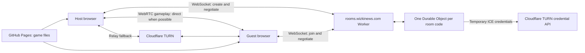

# Cloudflare signaling deployment

This replaces the publicly hosted Node service. Keep the browser game on GitHub Pages;
no always-on PC, Node process, or Cloudflare Tunnel is needed for the public backend.
Anyone visiting the game can host a 2–8 player room and share its eight-digit code.
Room browsing is not included; joining still uses a code.

## Deploy from your computer

Use **Node.js 22 or newer** (current Wrangler requires it). From a terminal in the repo:

```sh
cd server/cloudflare
npm ci
npx wrangler login
npx wrangler whoami
```

Sign into the Cloudflare account that owns `wizkinews.com`. If you have multiple accounts,
set `account_id` in `wrangler.jsonc` to the intended account ID before continuing.

Set these two **Worker secrets**, entering the matching values already in `server/.env`
at the prompts. The local Node `.env` does not upload itself to Cloudflare.

```sh
npx wrangler secret put CLOUDFLARE_TURN_KEY_ID
npx wrangler secret put CLOUDFLARE_TURN_API_TOKEN
npm run deploy
```

Wrangler may offer to create the Worker during the first secret upload; accept that.
The TURN token must be allowed to generate credentials for the matching TURN key.
Never put either value in Godot, browser HTML, `wrangler.jsonc`, or Git.

The checked-in configuration creates the `multi-grappler-rooms` Worker, a SQLite Durable
Object namespace, and the custom domain **rooms.wizkinews.com**. Cloudflare manages DNS
and HTTPS for the custom domain; you do not need to point an A record at a server.
If `rooms` already has a DNS record or Tunnel route, remove that conflicting `rooms`
configuration first. Leave the GitHub Pages records for the main website as they are.
The first migration (`v1`) creates the namespace; keep it in the config for future deploys.

Open `https://rooms.wizkinews.com/health`; it should show `ok`. This checks that the
Worker is reachable, not that TURN credentials are valid. An actual Host/Join verifies
credential generation. `npx wrangler tail` shows runtime errors without logging secrets
or signaling payloads in our application code.

Then re-export the **Web** preset in Godot and upload the updated game to GitHub Pages.
The game automatically uses `wss://rooms.wizkinews.com` on `wizkinews.com` and
`www.wizkinews.com`. Localhost uses the local signaling service. On other domains, set
this before loading the Godot engine in the exported HTML (or the iframe's HTML):

```html
<script>window.MULTI_GRAPPLER_SIGNALING_URL = "wss://rooms.wizkinews.com";</script>
```

If the game lives in an iframe, allow the **iframe's origin** in `ALLOWED_ORIGINS`, not
just the parent page's origin. The checked-in origins cover your main website and local
port 8000. Add another exact origin to `wrangler.jsonc` and redeploy when needed.

## Test without deploying

```sh
cd server/cloudflare
npm ci
npm test
npm run check
npm run dev
```

`dev` serves the Worker and real local Durable Objects at `http://localhost:9080`.
Stop the original Node service first, since both use port 9080. Export/serve the browser
game as described in the root README, then open `http://localhost:8000` in multiple tabs.
Test at least three players, another simultaneous lobby, guest departures, and host exit.

Local development defaults to STUN only. To test actual TURN, copy `.dev.vars.example`
to `.dev.vars` and fill in your TURN key ID/token. `.dev.vars` is ignored by Git.
Tests use fake credentials and never call your TURN account.

For the automated Godot browser fixture, export with `tests/export_multiplayer_browser.py`,
then run the existing `server/browser-smoke.js` with `BROWSER_SIGNALING_URL` set to
`ws://127.0.0.1:9080`. For this test only, start Wrangler with an origin matching its
temporary HTTP port, for example `npm run dev -- --var ALLOWED_ORIGINS:http://127.0.0.1:8000`,
and run the fixture with `BROWSER_HTTP_PORT=8000`.
The fixture uses `server`'s Playwright dependency (`cd server` and `npm ci` once).
Install its browser with `npx playwright install chromium` if needed, or set `CHROME_PATH`
to an existing Chromium/Chrome executable.

After deployment, test from two devices on different Wi-Fi/cellular networks. Local
testing validates the protocol and game, but does not prove Internet TURN connectivity.

## How it works and how usage stays bounded



The Worker allocates a cryptographically random code and atomically reserves it in that
code's object. Joins connect to `/rooms/12345678`, routing directly to the same object.
The Godot create/join/signal messages otherwise match the local Node protocol. Only the
host negotiates with guests; clients cannot supply their own sender IDs.

Room metadata lives in SQLite-backed storage; peer IDs and setup/rate state are attached
to hibernating WebSockets. They survive object eviction without keeping the object awake.
Movement and grapples never pass through Workers or Durable Objects.

Godot sends an exact JSON heartbeat every 15 seconds. Cloudflare automatically replies
without waking the object. A cleanup alarm checks for dead connections roughly every
three minutes, adjusted to each peer's latest heartbeat; these alarms do incur request,
brief compute, and storage-operation usage. Host exit closes all guests and deletes room
storage. An abruptly disconnected host is removed after about three minutes without a
heartbeat. A completely suspended browser can therefore lose its session.

Defaults in `wrangler.jsonc`:

- 2–8 players per lobby; pending joins reserve slots while TURN credentials are fetched.
- New connections must finish create/join within 30 seconds.
- Rooms expire after **12 hours** (`ROOM_TTL_SECONDS`, configurable from 5 minutes to 24 hours).
- TURN credentials expire after **24 hours** (`TURN_TTL_SECONDS`). They are minted per player.
- Per public IP, about 20 host attempts and 120 connection attempts per minute, using
  Workers' approximate, per-location rate limits. Large groups sharing one public IP
  share that allowance. Change the limits if needed; namespace IDs must be unique among
  your unrelated rate limit bindings.
- Each socket accepts 300 signaling messages per 10 seconds, with a 32 KiB message limit.

These controls bound ordinary abandoned-room usage; they are not a hard billing cap or
authentication. Public players use your account's Workers, Durable Objects, and TURN.
Watch those three usage dashboards. Frequent joins, cleanup alarms, and signaling messages
consume usage; connected players do not require continuously running compute while their
room is eligible for hibernation. Existing lobbies may disconnect during a backend deployment.

Official references: [WebSocket hibernation](https://developers.cloudflare.com/durable-objects/best-practices/websockets/),
[automatic heartbeat responses](https://developers.cloudflare.com/durable-objects/api/state/#setwebsocketautoresponse),
[custom domains](https://developers.cloudflare.com/workers/configuration/routing/custom-domains/),
[TURN credentials](https://developers.cloudflare.com/realtime/turn/generate-credentials/),
and [Durable Objects pricing](https://developers.cloudflare.com/durable-objects/platform/pricing/).
